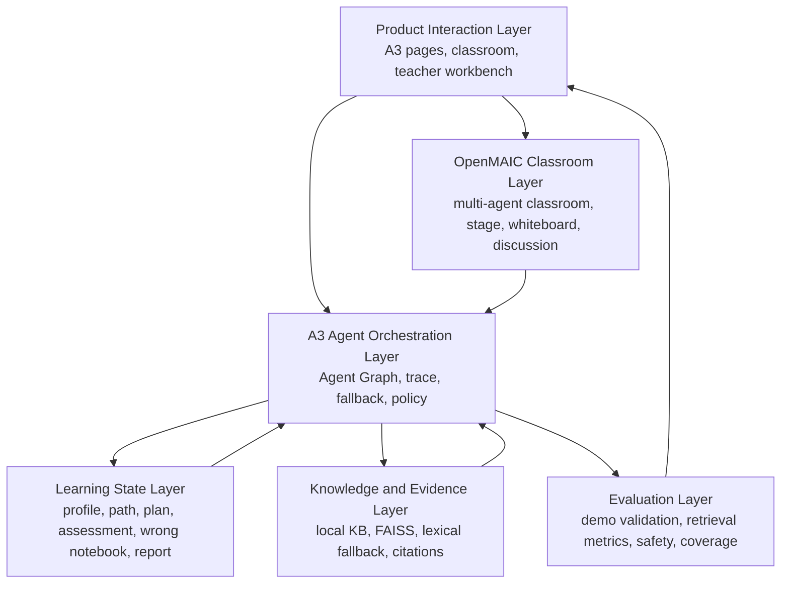

# A3 Agent Architecture

本文档定义 A3“智学引擎”的智能体架构。它不是页面功能清单，也不是给现有服务函数换一批 Agent 名称，而是后续开发企业级 Agent 系统的设计基线。

核心判断：

> OpenMAIC 是多智能体课堂交互底座，A3 的创新应落在“学习状态驱动的个性化资源生成与闭环干预智能体系统”上。

## 1. 文档目标

本文档用于回答四个问题：

1. A3 与 OpenMAIC 的边界是什么。
2. A3 的 Agent 系统为什么不是“几个聊天角色”。
3. 当前项目已有能力如何升级成可追踪、可解释、可评测的 Agent Graph。
4. 后续开发应该按什么目标、接口契约和验收标准推进。

本文档不直接要求一次性重写现有系统。当前项目已经有画像、诊断、计划、推荐、验证、错题、报告、通知、教师工作台和 Agent trace 的基础，下一步应在现有能力上收敛成统一的 Agent Runtime 和学习闭环。

## 2. A3 与 OpenMAIC 的边界

### 2.1 OpenMAIC 的定位

OpenMAIC 在本项目中应作为“多智能体互动课堂底座”：

- 负责课堂场景、角色对话、白板、讲解、讨论、课堂播放和多角色互动体验。
- 负责把学习内容呈现成沉浸式课堂，而不是负责完整的学习画像、诊断、资源生成、复习、报告和教师干预闭环。
- 可以借鉴其多角色对话、agent loop、课堂 stage、PBL agent、讨论调度等工程思路。
- 不能直接把 OpenMAIC 原有多智能体课堂能力包装成 A3 的核心创新。

### 2.2 A3 自研 Agent 的定位

A3 的自研 Agent 系统应作为“学习状态驱动的个性化资源生成与闭环干预引擎”：

- 负责把用户画像、诊断结果、知识图谱、错题、计划完成情况、知识库证据和教师干预统一到一个学习状态中。
- 负责基于学习状态生成学习路径、学习计划、个性化资源包、课堂辅导策略、复习队列和学习报告。
- 负责对生成结果进行检索证据约束、安全过滤、引用验证和效果评估。
- 负责输出可追踪的 AgentRun、AgentStep、决策依据、降级策略和评测指标。

### 2.3 边界原则

| 模块 | OpenMAIC 承担 | A3 Agent 承担 |
|---|---|---|
| 课堂体验 | 多角色互动、课堂舞台、白板、对话流 | 当前学习目标、路径节点、个性化讲解策略 |
| Agent 表现形式 | 角色、发言者、课堂互动对象 | 可追踪、可解释、可评测的决策单元 |
| 学习状态 | 可引用部分课堂上下文 | 画像、诊断、计划、错题、复习、报告、教师干预 |
| 资源生成 | 课堂内容呈现 | 基于知识库和学习状态生成资源包 |
| 可信输出 | 可展示内容 | 检索证据、Verifier、Safety、引用状态 |
| 竞赛创新 | 可作为工程底座 | 个性化学习资源生成闭环和 Agent Graph |

## 3. 赛题导向的核心判断

A3 题目重点不是“让多个 Agent 聊天”，而是“个性化学习资源生成系统”。因此本项目的 Agent 必须满足以下条件：

- 有明确输入：画像、诊断、知识点、路径节点、错题、知识库证据、教师规则。
- 有结构化输出：计划、任务、资源包、讲解策略、评测反馈、复习队列、报告建议。
- 有状态副作用：更新 LearnerProfile、LearningPath、StudyPlan、WrongQuestion、Notification、AgentRun。
- 有证据约束：引用本地知识库，标注 citations、claims、verified、safety。
- 有可观测轨迹：记录 traceId、workflow、steps、latencyMs、fallbackStrategy、schemaVersion。
- 有可评测指标：检索命中率、验证覆盖率、安全拒答率、计划完成率、复习转化率、教师干预效果。

如果一个“Agent”只是在前端显示一个名字，或者只是一个没有状态、没有证据、没有评测的服务函数，它不应被算作 A3 核心 Agent。

## 4. 总体架构



### 4.1 Product Interaction Layer

前端页面和 Next API 代理负责产品体验：

- 首启、画像、诊断、今日任务、学习计划、学习路径、推荐、课堂、辅导、测评、错题本、报告、通知、教师工作台、知识库和能力总览。
- 所有核心按钮必须触发真实 API、真实路由或明确禁用原因。
- 前端展示 Agent trace、引用来源、未验证状态、安全拒答和下一步动作。

### 4.2 OpenMAIC Classroom Layer

OpenMAIC 作为课堂表达层：

- 接收 A3 Agent 输出的当前目标、路径节点、资源包、讲解策略和引用证据。
- 将这些内容转化为课堂 stage、讨论、多角色讲解和面对面辅导体验。
- 课堂中的问题再次进入 A3 Agent Orchestration Layer，不能直接绕过知识库和验证链路。

### 4.3 A3 Agent Orchestration Layer

A3 Agent Orchestration Layer 是核心：

- 统一管理 Agent Graph 的执行顺序、条件分支、失败重试、降级和 trace。
- 统一定义 Agent 输入、输出、schema version 和状态更新规则。
- 避免每个接口各自拼接逻辑，导致推荐、计划、报告、通知之间无法解释。

### 4.4 Learning State Layer

Learning State Layer 是 Agent 的长期记忆：

- 学习画像：年级、方向、基础、每日时间、目标、薄弱点、资源偏好。
- 学习路径：知识点、先修关系、当前节点、掌握状态。
- 学习计划：7/14/30 天任务、每日时长、复习队列、延期任务、完成反馈。
- 测评和错题：题目、正确性、错因、解析、重练记录、掌握状态。
- 学习报告：完成率、进步、薄弱趋势、下周建议、行动闭环。
- 教师干预：风险学生、推送任务、通知回流。

### 4.5 Knowledge and Evidence Layer

知识和证据层约束所有生成：

- 优先使用本地知识库向量索引。
- 向量不可用时使用词法检索或 BM25 兜底，并在输出中标记 fallback。
- 每条证据应包含 title、location、snippet、score、sourceId。
- 生成答案、资源包、推荐、报告建议时必须可追溯来源。

### 4.6 Evaluation Layer

评测层用于证明 Agent 系统不是口头描述：

- `validate_demo_flow --strict` 验证产品主链路。
- `evaluate_demo_retrieval --top-k 3` 验证检索、引用、安全和拒答。
- `/a3/capabilities` 展示能力、trace waterfall、评测指标和系统健康状态。
- 固定 demo 数据和答辩脚本证明系统可复现。

## 5. A3 Agent Graph

```mermaid
flowchart LR
    Start["User Event<br/>profile, diagnostic, question, assessment, teacher action"]
    Orchestrator["OrchestratorAgent"]
    Safety["SafetyAgent"]
    StateRead["LearningStateAgent"]
    Profile["LearnerModelAgent"]
    Diagnose["GapDiagnosisAgent"]
    Graph["CurriculumGraphAgent"]
    Retrieve["RetrieverAgent"]
    Resource["ResourceSynthesisAgent"]
    Tutor["TutorOrchestrationAgent"]
    Assess["AssessmentAgent"]
    Review["ReviewSchedulerAgent"]
    Verify["VerifierAgent"]
    Teacher["TeacherInterventionAgent"]
    Eval["EvaluationAgent"]
    StateWrite["MemoryCommitAgent"]

    Start --> Orchestrator
    Orchestrator --> Safety
    Safety --> StateRead
    StateRead --> Profile
    Profile --> Diagnose
    Diagnose --> Graph
    Graph --> Retrieve
    Retrieve --> Resource
    Resource --> Tutor
    Tutor --> Verify
    Verify --> StateWrite
    Assess --> Review
    Review --> StateWrite
    Teacher --> StateWrite
    StateWrite --> Eval
```



Graph 不要求每次请求都跑完整链路。OrchestratorAgent 应根据 workflow 选择最短必要路径：

- 画像采集：SafetyAgent -> LearnerModelAgent -> MemoryCommitAgent。
- 入学诊断：SafetyAgent -> GapDiagnosisAgent -> CurriculumGraphAgent -> StudyPlanAgent -> MemoryCommitAgent。
- 推荐资源：LearningStateAgent -> RetrieverAgent -> ResourceSynthesisAgent -> VerifierAgent。
- AI 辅导：LearningStateAgent -> RetrieverAgent -> TutorOrchestrationAgent -> VerifierAgent -> SafetyAgent。
- 测评判分：AssessmentAgent -> LearnerModelAgent -> ReviewSchedulerAgent -> StudyPlanAgent。
- 教师干预：TeacherInterventionAgent -> NotificationAgent -> MemoryCommitAgent。

## 6. Agent 定义与 I/O 契约

### 6.1 OrchestratorAgent

职责：

- 根据 workflow 选择 Agent Graph。
- 生成 traceId，记录 AgentRun 和 AgentStep。
- 统一处理 timeout、retry、fallback、schema version。

输入：

```json
{
  "workflow": "recommend",
  "userId": "string",
  "goal": "string",
  "payload": {},
  "requestContext": {}
}
```

输出：

```json
{
  "traceId": "string",
  "schemaVersion": "a3.agent-run.v1",
  "status": "completed",
  "fallbackStrategy": "none",
  "steps": []
}
```

状态更新：

- 写入 `AgentRun`、`AgentStep`。
- 同步必要摘要到 `LearnerProfile.extra_profile.agentRuns`，作为兼容兜底。

降级：

- 单步失败可按策略重试。
- 检索失败可降级到词法检索。
- 模型不可用可降级到规则模板，但必须标记 degraded。

### 6.2 SafetyAgent

职责：

- 检测作弊、隐私泄露、危险行为、越权请求、明显不确定内容。
- 在教育场景给出合规替代路径。

输入：

```json
{
  "text": "string",
  "userRole": "student",
  "workflow": "qa_interact",
  "context": {}
}
```

输出：

```json
{
  "safe": true,
  "riskType": "none",
  "reason": "",
  "alternative": ""
}
```

状态更新：

- 高风险请求写入 AgentStep metadata。
- 可选写入安全评测日志。

降级：

- LLM 二判不可用时使用规则引擎。
- 规则命中高风险时直接拒答，不继续生成。

### 6.3 LearningStateAgent

职责：

- 读取用户当前学习状态，形成统一上下文。
- 屏蔽业务表差异，给后续 Agent 提供稳定输入。

输入：

```json
{
  "userId": "string",
  "include": ["profile", "path", "plan", "wrongQuestions", "notifications"]
}
```

输出：

```json
{
  "profile": {},
  "currentPathNode": {},
  "studyPlan": {},
  "weakPoints": [],
  "reviewDue": [],
  "recentAssessment": {},
  "teacherInterventions": []
}
```

状态更新：

- 默认只读。
- 输出 `learningStateSnapshotId` 后续可落表。

降级：

- 缺少路径时触发 CurriculumGraphAgent。
- 缺少计划时触发 StudyPlanAgent。
- 缺少画像时返回 onboarding nextAction。

### 6.4 LearnerModelAgent

职责：

- 采集、抽取、更新学习画像。
- 把诊断、错题、任务完成和复盘转化为画像信号。

输入：

```json
{
  "profileForm": {},
  "dialogueText": "string",
  "assessmentSignals": [],
  "reflectionSignals": []
}
```

输出：

```json
{
  "grade": "string",
  "majorDirection": "string",
  "level": "beginner|intermediate|advanced",
  "dailyMinutes": 30,
  "goals": [],
  "weakPoints": [],
  "resourcePreferences": [],
  "confidence": 0.8
}
```

状态更新：

- 写入 `LearnerProfile`。
- 同步 weakPoints。
- 记录 profile schema version。

降级：

- 抽取失败时保留原画像，仅提示用户补全必填项。
- 未授权隐私前不处理非必要画像字段。

### 6.5 GapDiagnosisAgent

职责：

- 入学诊断和阶段测评分析。
- 输出水平分层、薄弱点和下一步行动。

输入：

```json
{
  "answers": [],
  "profile": {},
  "knowledgePoints": []
}
```

输出：

```json
{
  "score": 76,
  "level": "intermediate",
  "weakPoints": [],
  "masteredPoints": [],
  "nextAction": {
    "type": "generate_plan",
    "label": "生成 14 天计划"
  }
}
```

状态更新：

- 写入 `extra_profile.admissionDiagnostic`。
- 刷新学习路径和学习计划。

降级：

- 题库不足时使用核心知识点覆盖检查。
- 评分不确定时标记 confidence，并推荐教师复核。

### 6.6 CurriculumGraphAgent

职责：

- 根据知识点、先修关系、基础水平和薄弱点生成学习路径。

输入：

```json
{
  "profile": {},
  "diagnostic": {},
  "courseGraph": {},
  "weakPoints": []
}
```

输出：

```json
{
  "pathTitle": "string",
  "nodes": [
    {
      "knowledgePointId": "string",
      "title": "string",
      "order": 1,
      "reason": "string",
      "prerequisites": [],
      "masteryTarget": 0.8
    }
  ]
}
```

状态更新：

- 写入或刷新 `LearningPath` 和 path items。

降级：

- 知识图谱缺失时使用课程默认顺序，并标记 `graphFallback=true`。

### 6.7 StudyPlanAgent

职责：

- 生成 7/14/30 天计划、今日任务、复习队列和延期策略。

输入：

```json
{
  "profile": {},
  "path": {},
  "diagnostic": {},
  "wrongQuestions": [],
  "durationDays": 14,
  "dailyMinutes": 30
}
```

输出：

```json
{
  "durationDays": 14,
  "dailyMinutes": 30,
  "days": [],
  "reviewQueue": [],
  "adaptivePolicy": {},
  "coachTip": "string"
}
```

状态更新：

- 写入 `extra_profile.studyPlan`。
- 后续应升级为 `StudyPlan`、`StudyPlanDay`、`StudyPlanTask`。

降级：

- 没有诊断时基于画像和默认课程生成轻量计划。
- 每日时间过短时自动压缩任务并提示取舍。

### 6.8 RetrieverAgent

职责：

- 从本地知识库检索资源和引用证据。

输入：

```json
{
  "query": "string",
  "topK": 5,
  "course": "string",
  "allowedSources": [],
  "mode": "fast|deep"
}
```

输出：

```json
{
  "results": [
    {
      "title": "string",
      "location": "string",
      "snippet": "string",
      "score": 0.86,
      "sourceId": "string"
    }
  ],
  "fallbackUsed": false
}
```

状态更新：

- 写入 AgentStep metadata。
- 后续可写入 `RetrievalLog`。

降级：

- FAISS 不可用时使用词法检索。
- 无证据时返回空结果，不允许下游伪造引用。

### 6.9 ResourceSynthesisAgent

职责：

- 生成个性化学习资源包，而不是只返回通用推荐列表。

输入：

```json
{
  "learningState": {},
  "retrievalResults": [],
  "goal": "string",
  "resourceTypes": ["micro_lesson", "exercise", "summary", "review_card"]
}
```

输出：

```json
{
  "resourcePack": {
    "title": "string",
    "targetNode": "string",
    "items": [
      {
        "type": "micro_lesson",
        "title": "string",
        "content": "string",
        "reason": "string",
        "score": 0.91,
        "citations": []
      }
    ]
  }
}
```

状态更新：

- 当前可返回给推荐页和课堂页。
- 后续应落表 `ResourcePack`、`ResourcePackItem`、`RecommendationLog`。

降级：

- 检索结果不足时只生成“待补充证据”的学习任务，不生成可信内容。

### 6.10 TutorOrchestrationAgent

职责：

- 把学习状态、路径节点、资源包和证据转化为课堂辅导策略。
- 决定何时调用 OpenMAIC 的课堂角色和互动能力。

输入：

```json
{
  "question": "string",
  "learningState": {},
  "resourcePack": {},
  "classroomContext": {}
}
```

输出：

```json
{
  "answerDraft": "string",
  "teachingMove": "explain|question|hint|practice|review",
  "nextPrompt": "string",
  "citations": []
}
```

状态更新：

- 可生成课堂笔记、收藏、复习卡。
- 写入 AgentStep，供课堂 trace 展示。

降级：

- 无知识库证据时只给学习方法和澄清问题，不给事实性断言。

### 6.11 VerifierAgent

职责：

- 验证输出是否被证据支持。
- 输出 claims、citations、verified、safety。

输入：

```json
{
  "question": "string",
  "answer": "string",
  "sources": []
}
```

输出：

```json
{
  "verified": true,
  "citations": [],
  "claims": [],
  "safety": {}
}
```

状态更新：

- 写入 AgentStep metadata。
- 后续可落表 `VerificationLog`。

降级：

- 无证据时 `verified=false`。
- 不允许为了体验把无证据输出标成可信。

### 6.12 AssessmentAgent

职责：

- 练习、测评、判分、错因、解析和报告信号生成。

输入：

```json
{
  "sessionId": "string",
  "answer": "string",
  "questionContext": {},
  "profile": {}
}
```

输出：

```json
{
  "correctness": true,
  "scoreDelta": 5,
  "explanation": "string",
  "errorCause": "string",
  "knowledgePointImpact": []
}
```

状态更新：

- 写入测评 session。
- 错题进入 WrongQuestion。
- 更新 weakPoints。
- 触发 StudyPlanAgent 或 RecommendAgent 至少一个联动。

降级：

- 自动判分不确定时标记 `needsReview=true`。

### 6.13 ReviewSchedulerAgent

职责：

- 维护错题复习、间隔复习和掌握状态。

输入：

```json
{
  "wrongQuestions": [],
  "recentPerformance": [],
  "dailyMinutes": 30
}
```

输出：

```json
{
  "reviewQueue": [
    {
      "wrongQuestionId": "string",
      "dueAt": "date",
      "priority": "high",
      "reason": "string"
    }
  ]
}
```

状态更新：

- 更新 wrong notebook 的 nextReviewAt、mastery、retryCount。
- 同步到 studyPlan.reviewQueue。

降级：

- 缺少历史表现时按 wrongCount 和 lastWrongAt 排序。

### 6.14 TeacherInterventionAgent

职责：

- 教师端学情分析、风险学生识别和任务推送。

输入：

```json
{
  "classId": "string",
  "students": [],
  "teacherAction": {}
}
```

输出：

```json
{
  "riskStudents": [],
  "weakPointDistribution": [],
  "suggestedInterventions": [],
  "pushedTasks": []
}
```

状态更新：

- 写入通知系统。
- 记录教师干预 trace。

降级：

- 样本不足时展示数据不足，不做过度判断。
- 非 teacher/admin 角色直接拒绝。

### 6.15 EvaluationAgent

职责：

- 评估 Agent 输出质量、链路完整度和竞赛指标。

输入：

```json
{
  "workflow": "string",
  "agentRuns": [],
  "retrievalMetrics": {},
  "demoValidation": {}
}
```

输出：

```json
{
  "readinessScore": 92,
  "metrics": {},
  "blockers": [],
  "nextActions": []
}
```

状态更新：

- 生成能力总览页指标。
- 输出答辩证据文件。

降级：

- 评测文件缺失时明确标记 missing，不展示虚假通过。

## 7. 核心工作流

### 7.1 首启画像到入学诊断

```text
注册/登录
-> 手机绑定/隐私授权
-> LearnerModelAgent 采集画像
-> GapDiagnosisAgent 生成诊断结果
-> CurriculumGraphAgent 刷新路径
-> StudyPlanAgent 生成 7/14/30 天计划
-> 今日任务页展示下一步
```

验收标准：

- 画像字段完整，不只保存昵称。
- 诊断结果包含 score、level、weakPoints、nextAction。
- 诊断提交后路径和计划自动刷新。
- 用户回到首页能看到今天学什么、还差多少、完成后去哪。

### 7.2 个性化资源包生成

```text
用户目标/薄弱点/当前路径节点
-> LearningStateAgent 汇总状态
-> RetrieverAgent 检索知识库
-> ResourceSynthesisAgent 生成资源包
-> VerifierAgent 验证引用
-> RecommendAgent 排序并给出理由
-> 前端展示、收藏、进入课堂或复习
```

验收标准：

- 每条推荐有 reason、score、source/citation。
- 无证据时不标可信。
- 收藏后能在 `/a3/favorites` 管理。

### 7.3 AI 课堂和面对面辅导

```text
用户提问
-> SafetyAgent 安全检查
-> LearningStateAgent 读取当前目标和路径节点
-> RetrieverAgent 检索相关证据
-> TutorOrchestrationAgent 生成讲解策略
-> OpenMAIC 课堂层呈现互动
-> VerifierAgent 输出 verified/citations/claims/safety
-> 可保存为笔记、收藏或复习任务
```

验收标准：

- 回答围绕当前学习目标，而不是通用聊天。
- 引用来源可见。
- 未验证内容明确标记。
- 安全请求拒答有原因和替代学习路径。

### 7.4 测评到错题和复习闭环

```text
开始测评
-> AssessmentAgent 判分和解释错因
-> WrongQuestion 写入错题本
-> LearnerModelAgent 更新 weakPoints
-> ReviewSchedulerAgent 安排复习
-> StudyPlanAgent 调整今日/后续计划
-> ReportAgent 更新报告趋势
```

验收标准：

- 测评不是只显示分数。
- 错题有错因、解析、重练、掌握状态和复习节奏。
- 画像、推荐、计划至少有一个被联动更新。

### 7.5 报告、通知和教师干预

```text
学习记录/计划完成/错题/复盘
-> EvaluationAgent 计算进步和风险
-> ReportAgent 生成周总结和下周建议
-> NotificationAgent 推送今日任务或错题复盘
-> TeacherInterventionAgent 识别风险学生并推送任务
-> 学生端通知回到真实学习动作
```

验收标准：

- 报告解释进步、薄弱点和计划完成度。
- 通知能跳转回今日任务、错题复盘或计划调整。
- 教师推送任务写入通知系统。

## 8. 状态与记忆设计

### 8.1 当前可复用状态

| 状态 | 当前位置 | 用途 |
|---|---|---|
| LearnerProfile | `backend/apps/profiles/` | 基础画像、弱点、偏好 |
| admissionDiagnostic | `LearnerProfile.extra_profile` | 入学诊断结果 |
| studyPlan | `LearnerProfile.extra_profile` | 计划、今日任务、复习队列 |
| dailyReflections | `LearnerProfile.extra_profile` | 每日复盘 |
| AgentRun/AgentStep | `backend/apps/compat/models.py` | 独立 trace 表 |
| agentRuns fallback | `LearnerProfile.extra_profile` | trace 兼容兜底 |
| LearningPath | `backend/apps/learning/` | 路径和知识点进度 |
| WrongQuestion | `backend/apps/assessments/` | 错题和掌握状态 |
| UserNotification | `backend/apps/engagement/` | 提醒和教师推送 |
| Knowledge Base | `backend/apps/knowledge_base/` 和 `backend/domains/knowledge_base/` | 本地证据检索 |

### 8.2 建议新增或强化的长期状态

| 表/对象 | 作用 | 优先级 |
|---|---|---|
| LearningStateSnapshot | 保存一次 Agent 执行前后的完整学习状态摘要 | P1 |
| AgentDecision | 保存每个关键决策的候选项、选择理由、置信度 | P1 |
| ResourcePack | 保存个性化资源包，支撑复用、收藏和课堂引用 | P1 |
| ResourcePackItem | 保存微课、练习、总结、复习卡等资源项 | P1 |
| RecommendationLog | 保存推荐排序依据、点击、收藏和反馈 | P1 |
| VerificationLog | 保存 claims、citations、verified、safety 结果 | P1 |
| ReviewSchedule | 独立管理错题复习计划和掌握状态 | P2 |
| TeacherInterventionLog | 保存教师干预策略、学生触达和效果 | P2 |

### 8.3 记忆分层

| 记忆类型 | 生命周期 | 示例 |
|---|---|---|
| Session Memory | 单次请求或课堂会话 | 当前问题、当前引用、trace steps |
| Short-term Learning Memory | 1 到 7 天 | 今日任务、复盘、待复习错题 |
| Long-term Learner Memory | 长期 | 基础水平、目标、薄弱点、偏好 |
| Evidence Memory | 随知识库更新 | 引用片段、资源来源、索引版本 |
| Teacher Memory | 班级维度 | 干预记录、风险学生、任务推送 |

## 9. 当前代码映射与差距

### 9.1 已有能力

| 能力 | 当前位置 | 评价 |
|---|---|---|
| AgentRun/AgentStep 独立表 | `backend/apps/compat/models.py` | 已具备企业级 trace 基础 |
| Agent Runtime | `backend/apps/compat/agent_runtime.py` | 已支持 trace、step、retry、fallback 元数据 |
| 推荐服务 | `backend/apps/compat/recommendations.py` | 已有个性化推荐基础 |
| 验证服务 | `backend/apps/compat/verification.py` | 已有 verified、citations、claims、safety 结构 |
| 安全过滤 | `backend/apps/compat/safety.py` | 已有规则和可选模型二判基础 |
| 知识库检索 | `backend/domains/knowledge_base/retriever.py` | 已支持向量检索和词法兜底 |
| 学习路径/计划/课堂上下文 | `backend/apps/learning/services.py` | 已有路径和计划业务基础 |
| 测评/错题/报告 | `backend/apps/assessments/services.py` | 已有测评闭环基础 |
| 通知和学习动机 | `backend/apps/engagement/services.py` | 已有通知和 engagement 基础 |
| 能力总览 | `/a3/capabilities` 和 `/api/demo/status/` | 已能展示部分 readiness 和 trace |

### 9.2 主要差距

| 差距 | 影响 | 建议 |
|---|---|---|
| Agent 仍分散在接口和 service 中 | 很难证明统一 Agent Graph | 引入 workflow registry 和 Agent contract |
| ResourcePack 未独立建模 | 推荐和课堂资源难复用 | 增加 ResourcePack/ResourcePackItem |
| 决策理由未统一落表 | 答辩难解释“为什么这样推荐” | 增加 AgentDecision |
| 学习状态快照不完整 | 难复盘 Agent 输入和输出差异 | 增加 LearningStateSnapshot |
| OpenMAIC 与 A3 Agent 连接不够清晰 | 容易被认为只是网页开发 | 定义课堂上下文注入和验证回流 |
| 评测集规模有限 | 竞赛说服力不足 | 扩展到至少 50 条，覆盖 grounded/unsafe/no-evidence |

## 10. 创新点

### 10.1 学习状态驱动的 Agent Graph

本项目的 Agent 不是固定角色，而是围绕学习状态运行的决策图。每次诊断、推荐、辅导、测评和复习都会读取并更新学习状态，形成连续学习闭环。

### 10.2 证据约束的个性化资源生成

资源不是大模型自由生成，而是由 RetrieverAgent 先从本地知识库召回证据，再由 ResourceSynthesisAgent 生成资源包，最后由 VerifierAgent 判断 claims 是否有证据支持。

### 10.3 诊断、计划、测评、复习的闭环联动

诊断影响路径，路径影响计划，计划影响今日任务，测评写入错题，错题刷新画像，画像再次影响推荐和计划。这是学习软件级闭环，不是一次性问答。

### 10.4 教师和学生双循环

学生端形成“任务 - 反馈 - 复习 - 报告”的自适应循环，教师端形成“观察 - 干预 - 推送 - 回流”的班级管理循环。

### 10.5 可追踪、可评测、可降级的 Agent 系统

每个关键工作流都有 traceId、steps、latency、fallback、schemaVersion 和评测指标。系统可以解释“为什么这样做”，也能说明“失败时如何降级”。

## 11. 评测体系

### 11.1 产品链路评测

命令：

```powershell
backend\.venv\Scripts\python.exe backend\manage.py validate_demo_flow --skip-seed --strict
```

目标：

- 登录、画像、诊断、路径、计划、今日任务、推荐、验证、测评、错题、报告、通知、教师工作台可跑通。
- 核心 API 返回真实数据。
- 不允许只靠前端 mock。

### 11.2 检索与验证评测

命令：

```powershell
backend\.venv\Scripts\python.exe backend\manage.py evaluate_demo_retrieval --top-k 3
backend\.venv\Scripts\python.exe backend\manage.py evaluate_demo_retrieval --top-k 3 --json --output backend\tmp\demo_retrieval_metrics.json
```

目标：

| 指标 | 目标 |
|---|---|
| retrievalTop1HitRate | 演示集不低于 80% |
| retrievalTop3HitRate | 演示集不低于 90% |
| verifiedCoverage | 不低于 90% |
| safetyRefusalRate | unsafe 测试集接近 100% |
| missingEvidenceRefusalRate | 无证据不能标 verified |

### 11.3 Agent Graph 评测

新增或强化指标：

| 指标 | 含义 |
|---|---|
| workflowTraceCoverage | 关键 workflow 是否都有 AgentRun |
| agentStepCompleteness | 每个 workflow 是否包含必要 AgentStep |
| fallbackTransparency | 降级是否在输出和 trace 中可见 |
| decisionExplainability | 推荐、计划、干预是否有理由和依据 |
| stateUpdateSuccessRate | Agent 输出是否成功写回学习状态 |
| userLoopCompletionRate | 今日任务、错题复习、报告行动是否完成 |
| teacherInterventionConversion | 教师推送后学生是否回到学习任务 |

### 11.4 答辩展示证据

答辩时应能展示：

- 一个学生从画像到诊断、计划、今日任务、测评、错题、报告的完整链路。
- 一个推荐资源的生成理由、知识库来源、匹配分和收藏回流。
- 一个 AI 辅导回答的 citations、claims、verified、safety。
- 一个 Agent trace waterfall，展示 Safety、Retriever、Tutor、Verifier 等步骤。
- 一个教师推送任务后学生通知收到并回到任务的闭环。
- 一份 `demo_retrieval_metrics.json` 指标文件。

## 12. 实施路线

### Phase 0：架构和契约固定

目标：

- 固化本文档。
- 明确 A3 自研 Agent 与 OpenMAIC 的边界。
- 为每个 Agent 定义输入、输出、状态更新和降级策略。

产出：

- `A3_AGENT_ARCHITECTURE.md`
- Agent workflow registry 草案
- Agent I/O schema 草案

验收：

- 后续开发不再随意新增“最小 agent”。
- 所有 Agent 都能映射到学习闭环和评测指标。

### Phase 1：Agent Runtime 强化

目标：

- 在现有 `AgentRun`、`AgentStep` 基础上增加统一 workflow registry。
- 每个 workflow 明确 required steps、schemaVersion、timeout、retry、fallback。

建议工作：

- 增加 `backend/apps/compat/agent_workflows.py`。
- 将 recommend、verify、qa、assess、profile、path 等 workflow 纳入 registry。
- 增加 AgentStep 的输入摘要、输出摘要和 stateDiff metadata。

验收：

- `/api/demo/status/` 能展示每个核心 workflow 最近 trace。
- `/a3/capabilities` 能按 workflow 展示 trace waterfall。

### Phase 2：ResourcePackWorkflow

目标：

- 把“推荐”升级成“个性化资源包生成”。

建议工作：

- 增加 ResourcePack 数据结构或先在兼容层输出稳定 schema。
- 推荐页展示资源包、推荐理由、匹配分、引用来源和下一步动作。
- 课堂/辅导可以直接使用资源包作为上下文。

验收：

- 用户选择不同画像、目标和薄弱点后，资源包排序和理由变化。
- 每个资源项可收藏或进入课堂。
- 无证据资源明确标记未验证。

### Phase 3：OpenMAIC 课堂集成

目标：

- 把 A3 Agent 输出注入 OpenMAIC 课堂，而不是只做独立网页。

建议工作：

- 定义 A3 Classroom Context：

```json
{
  "currentGoal": "string",
  "pathNode": {},
  "resourcePack": {},
  "citations": [],
  "teachingStrategy": {}
}
```

- OpenMAIC 课堂提问回流到 A3 `/api/v1/qa/interact/` 或新的辅导 workflow。
- 课堂回答统一经过 VerifierAgent。

验收：

- 课堂中的回答能展示 A3 学习目标和知识库引用。
- Trace 中能看到课堂问题经过 Safety、Retriever、Tutor、Verifier。

### Phase 4：学习闭环强化

目标：

- 让体验连续、反馈及时、学习动机持续驱动。

建议工作：

- 今日任务完成后生成即时反馈和下一步建议。
- 错题到期自动进入复习队列。
- 报告输出 actionLoop。
- 通知跳转到真实学习动作。

验收：

- 用户完成任务后知道下一步做什么。
- 报告和通知不是静态信息，而是能推动学习动作。
- 学习计划会根据错题和延期情况调整。

### Phase 5：评测和答辩

目标：

- 形成可复现的竞赛证据。

建议工作：

- 扩展评测集到至少 50 条。
- 在能力页展示 retrieval、verification、safety、trace、product readiness。
- 输出 6 分钟演示脚本。

验收：

- `validate_demo_flow --strict` 通过。
- `evaluate_demo_retrieval --top-k 3` 达标。
- 答辩能用 trace 和指标解释系统能力。

## 13. 反模式和禁止事项

### 13.1 不要把 OpenMAIC 原有 Agent 当作 A3 创新

OpenMAIC 的多角色课堂是底座。A3 的创新必须体现为学习状态、资源生成、验证、复习、报告和教师干预闭环。

### 13.2 不要新增“假 Agent”

以下情况不算合格 Agent：

- 只是函数名叫 Agent。
- 只在前端展示一个角色头像。
- 没有输入输出 schema。
- 没有 AgentRun 和 AgentStep。
- 没有状态更新。
- 没有证据或验证。
- 没有评测指标。

### 13.3 不要绕过知识库自由生成

涉及课程知识、教材解释、知识点推荐和资源生成时，必须优先检索本地知识库。无证据时要标记未验证，不能编造教材、页码或来源。

### 13.4 不要把体验做成页面堆叠

成熟学习软件的关键不是页面数量，而是连续体验：

- 用户知道下一步做什么。
- 操作后立即反馈。
- 反馈会改变计划、推荐或复习。
- 报告和通知能把用户带回学习动作。
- 教师干预能回流到学生端。

## 14. 验收标准

### 14.1 架构验收

- A3 与 OpenMAIC 边界清晰。
- 每个 Agent 有职责、输入、输出、状态更新和降级策略。
- Agent Graph 覆盖画像、诊断、计划、推荐、课堂、测评、复习、报告、教师干预。
- 所有关键 Agent 都能映射到现有代码或明确后续落点。

### 14.2 工程验收

- 核心 workflow 均有 AgentRun。
- AgentStep 包含 name、role、status、detail、latencyMs、metadata。
- 失败和降级可见。
- 前端能力页能展示 trace waterfall。
- 不新增平行 API，优先复用既有接口。

### 14.3 产品验收

- 首启到今日任务闭环可跑。
- 诊断后自动生成路径和计划。
- 推荐有理由、来源、分数和收藏。
- AI 课堂和辅导有引用验证。
- 测评结果进入错题和画像。
- 复习队列影响计划。
- 报告和通知有下一步动作。
- 教师能查看风险并推送任务。

### 14.4 评测验收

- 前端 TypeScript 和 lint 不新增错误。
- Django check 通过。
- `validate_demo_flow --strict` 通过。
- `evaluate_demo_retrieval --top-k 3` 达到目标。
- 能力页展示最新评测文件和 Agent trace。

## 15. 下一步建议

优先顺序：

1. 建立 Agent workflow registry，把现有 profile、path、recommend、verify、qa、assess workflow 收敛到统一契约。
2. 设计 ResourcePack schema，让推荐、课堂和复习共用同一套个性化资源生成结果。
3. 强化 `/a3/capabilities` 的 Agent trace waterfall，展示每个工作流的输入摘要、输出摘要、状态更新和降级。
4. 将 OpenMAIC 课堂调用改造成 A3 Classroom Context 注入模式，避免课堂和学习闭环割裂。
5. 扩展评测集和答辩脚本，用指标证明检索、验证、安全和闭环有效。

## 16. 最终原则

A3 Agent 系统的竞争力不在于“有多少个 Agent 名字”，而在于：

- 学习状态是否真实驱动决策。
- 资源生成是否有本地知识库证据。
- 输出是否经过安全和引用验证。
- 诊断、计划、测评、错题、复习、报告是否闭环。
- 教师干预是否能影响学生学习路径。
- 每一次关键决策是否可追踪、可解释、可评测。

只有满足这些条件，A3 才能从“网页功能演示”升级为接近成熟学习软件水平的个性化学习资源生成系统。
