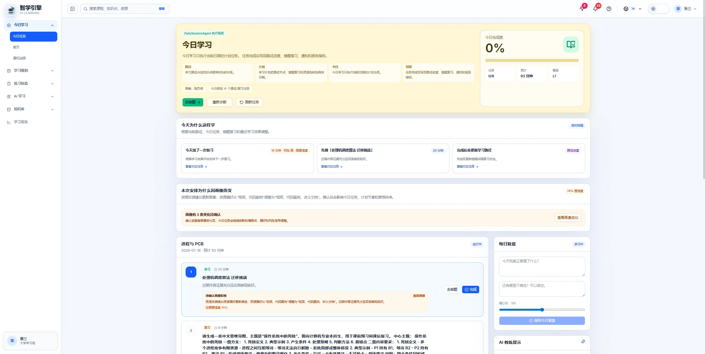
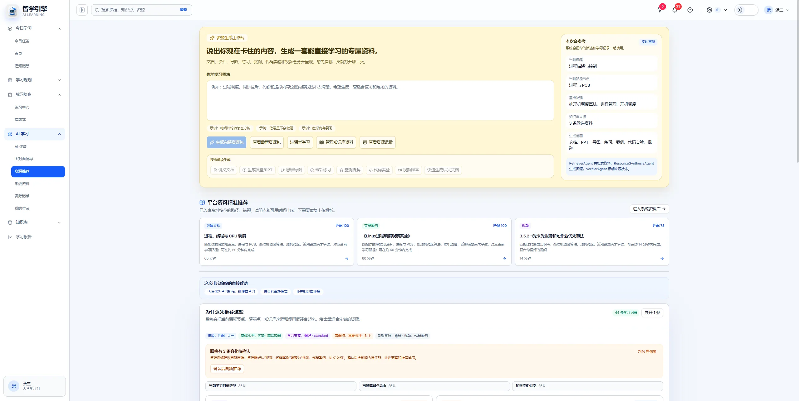
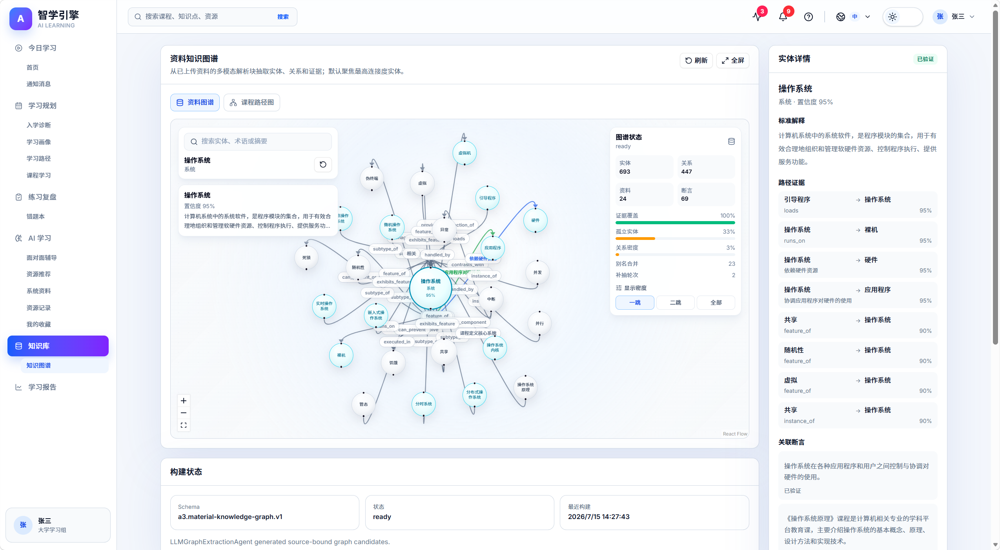
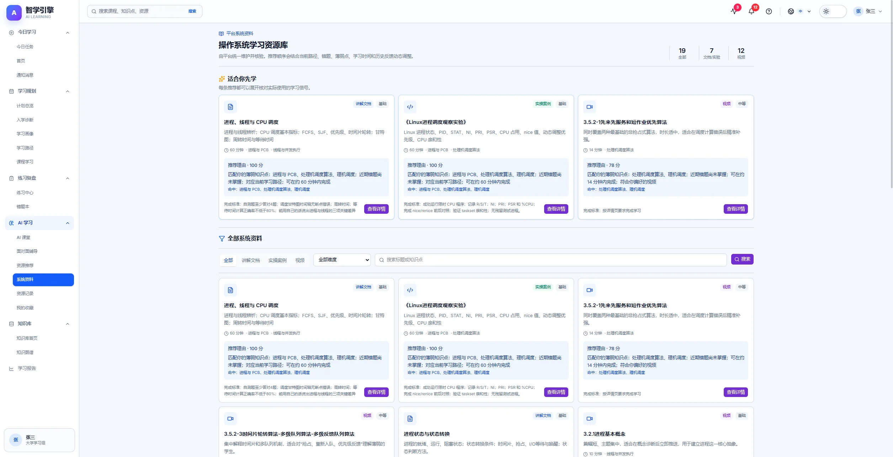
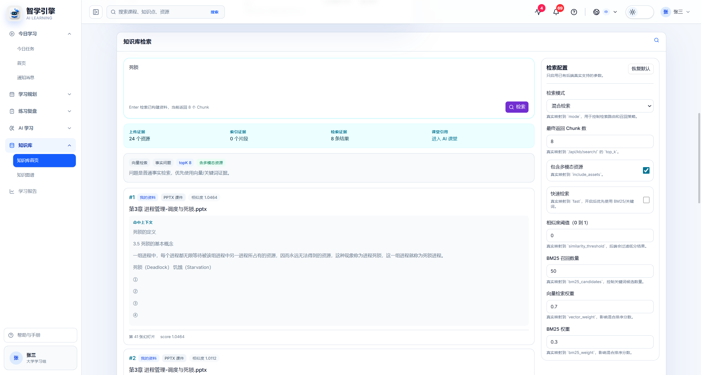
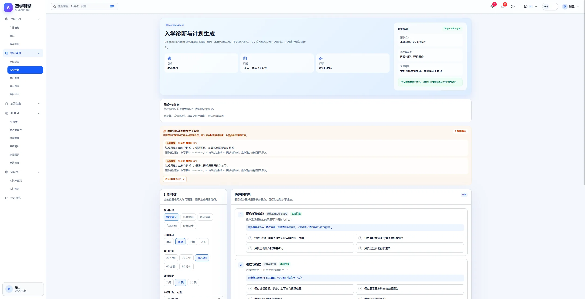
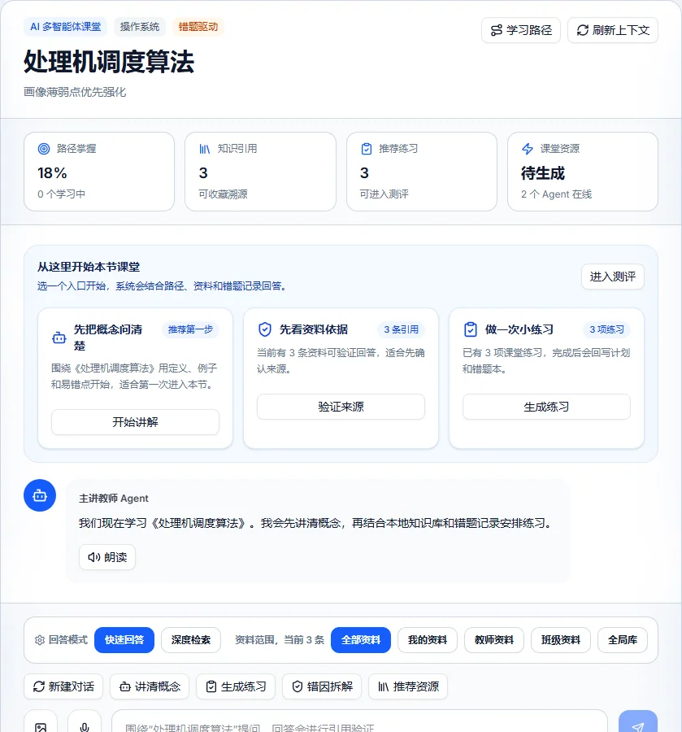
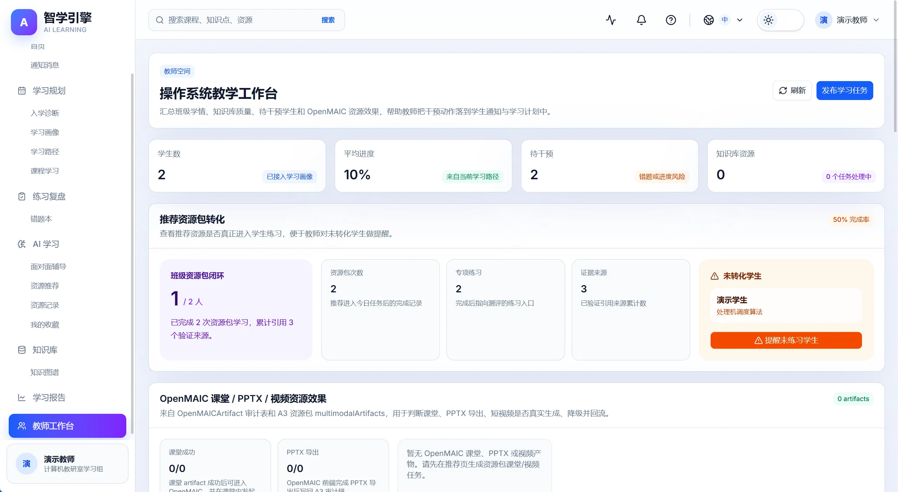
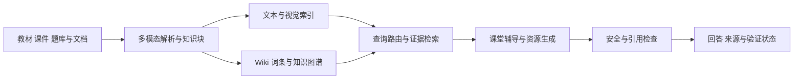

<div align="center">


# 智学引擎 A3

### 从今天学什么，到下一次真正学会

面向课程学习的多智能体平台，将学习诊断、个性化计划、课程 RAG、AI 辅导与测评复习连接起来。

[](OpenMAIC/package.json)
[](OpenMAIC/package.json)
[](backend/requirements.txt)
[](LICENSE)

[界面预览](#界面预览) · [核心设计](#核心设计) · [快速开始](#快速开始) · [验证与评测](#验证与评测) · [文档导航](#文档导航)

</div>



## 为什么做这个项目

学生并不缺少一次问答的入口，真正困难的是：不知道当前薄弱在哪里，不知道今天先学什么，也不知道做错之后如何安排下一轮学习。

智学引擎围绕这些连续的学习行为构建产品。它基于 OpenMAIC 的互动课堂能力，增加 A3 的业务后端、知识库、学习计划和反馈机制，让学习结果可以回到画像、路径、复习队列和教师工作台。

```text
画像与入学诊断 → 学习路径与周期计划 → 今日任务
        ↑                             ↓
报告与教师干预 ← 错题与间隔复习 ← 资源学习与测评
                                      ↑
                    课程知识库 → 推荐资源与 AI 辅导
```

项目面向中国软件杯 A3 个性化学习资源生成场景，当前示例课程以操作系统为主，也可通过上传资料扩展课程内容。

## 界面预览

### 让学习安排有理由

今日任务将计划、薄弱点和复习需求放在同一条学习路径上；资源工作台结合当前目标与课程来源，提供讲义、课堂 PPT、思维导图、练习、案例、代码实操和视频脚本等入口。



### 让课程知识可以追溯

资料知识图谱展示实体、关系与关联断言。选择一个概念，可以继续查看解释、关系证据及其来源；课程路径图则负责呈现先修关系与学习进度。



<details>
<summary><strong>展开查看知识库、检索、诊断、AI 课堂与教师端</strong></summary>

**资料管理**：上传课程文件，查看解析状态、索引任务与质量信息，进入检索和资料图谱。



**来源检索**：返回命中片段、文件名和页码或幻灯片位置，供用户回到原文核验。



**入学诊断**：将初始评估与后续学习规划连接起来。



**AI 课堂**：围绕课程问题讲解，区分资料证据与未验证内容，提供后续练习入口。



**教师工作台**：查看班级进度、待干预学生与资源效果，发起学习任务和提醒。



</details>

展示图来自本地保存的产品页面快照。不同截图的账号、资料规模和构建时间可能不同；其中的计数、分数与验证标记不代表统一基准或准确率评测。

## 核心设计

### 1 让学习结果影响下一步

- **采集与诊断**：记录年级、方向、基础水平、目标、薄弱点、每日时间和资源偏好。
- **路径与计划**：提供知识点路径、7 / 14 / 30 天计划、今日任务和复习队列。
- **测评与回流**：将答题结果、错因与学习进度写回，供后续推荐、计划和报告使用。
- **教师干预**：聚合进度、风险与资源效果，通过任务和通知把干预送回学生端。

### 2 用课程证据组织 RAG



解析结果保留资料标识、页码、幻灯片号等定位信息。检索支持向量、BM25 和结构化知识路由，具体可用模式取决于索引与 provider 配置；模型或语义索引不可用时，部分链路采用关键词或规则降级。

回答验证返回 `verified`、`citations`、`claims` 和 `safety`。当前基础验证包含词语重合规则，尚不能可靠识别所有语义矛盾，因此 **有引用、通过规则验证不等于事实一定正确**。来源可追溯与语义正确性应分别评测。

### 3 把生成任务留下来

推荐页发起资源包与课堂任务；后端记录任务状态、资源包和多模态产物。OpenMAIC 课堂前端负责 PPTX 导出，再将导出结果写回 A3。视频链路记录成功、失败或降级状态，缺少服务商密钥时不会冒充生成成功。

### 4 给工作流留下检查入口

Orchestrator 串联画像、规划、检索、推荐、辅导、验证和测评等 Agent，记录工作流与执行轨迹。能力页与 management commands 用于检查接口、演示流程和评测输出。

个人笔记使用独立的工作区与记忆确认流程；笔记记忆与课程 RAG 保持访问边界，课堂和面对面辅导不读取个人笔记记忆。

## 技术与目录

| 层次 | 技术与职责 |
| --- | --- |
| Web | Next.js 16、React 19、TypeScript、Tailwind CSS 4 |
| 业务后端 | Django、Django REST Framework、MySQL |
| 异步任务 | Celery、Redis、独立资源与视频任务 |
| 知识检索 | LlamaIndex、FAISS、BM25、文本与视觉索引、Wiki 与图谱 |
| 互动课堂 | 基于 OpenMAIC 的课堂生成、互动与 PPTX 导出 |
| 视频能力 | 外部生成服务与 OpenMontage 相关编排，依配置启用 |
| 验证工具 | TypeScript、ESLint、Vitest、Playwright、Django 命令与测试 |

```text
A3/
├── OpenMAIC/              # 前端 课堂底座与 A3 API 代理
│   ├── app/a3/            # 学生 教师 知识库与能力页面
│   ├── app/api/a3/        # 服务端桥接接口
│   └── components/a3/     # A3 产品组件
├── backend/
│   ├── apps/              # 认证 画像 学习 测评 笔记与管理
│   ├── apps/compat/       # Agent 工作流与业务兼容接口
│   └── domains/knowledge_base/
├── OpenMontage/           # 视频制作相关上游组件
├── data/                  # 本地课程资料 原始课程文件不随源码分发
├── docs/                  # 架构 接入边界与演示说明
├── scripts/               # 本地开发服务脚本
└── docker-compose.yml     # 开发环境编排
```

## 快速开始

### Docker 开发环境

准备 Docker Engine 与 Compose v2；首次构建需要下载 Python、Node、系统依赖和镜像，知识库模型也可能额外占用存储空间。

```bash
git clone https://github.com/zhuce30/A3.git
cd A3
docker compose up -d --build
docker compose ps
docker compose logs -f backend frontend
```

编排包含 MySQL、Redis、Django、前端、Celery 与专用工作进程。后端入口脚本配置为等待数据库、执行迁移和初始化演示数据。

| 入口 | 地址 |
| --- | --- |
| 产品首页 | http://localhost:3000/a3 |
| 登录 | http://localhost:3000/a3/login |
| 今日任务 | http://localhost:3000/a3/today |
| 知识库 | http://localhost:3000/a3/knowledge-base |
| 能力与证据 | http://localhost:3000/a3/capabilities |
| 后端 | http://localhost:8000 |

**本地演示账号**：学生 `13800000001`，教师 `13800000002`，密码均为 `Demo@123456`。仅用于自行启动的开发环境。

默认 Compose 含开发口令、演示账号和调试配置，适合本地复现；公网部署应配置独立密钥、关闭调试与开发验证码，并限制数据库和 Redis 的访问。

### 从源码开发

需要 Python 3.12、Node.js 20.9 或更新版本、pnpm 10.28、MySQL 和 Redis。以下命令在项目根目录执行；Windows 激活虚拟环境时使用 `backend\.venv\Scripts\Activate.ps1`。

```bash
python -m venv backend/.venv
source backend/.venv/bin/activate
python -m pip install -r backend/requirements.txt
cp backend/.env.example backend/.env
cp OpenMAIC/.env.example OpenMAIC/.env.local
```

编辑 `backend/.env`，为本地开发设置 `DJANGO_DEBUG=1`、MySQL 连接、`CACHE_REDIS_URL=redis://127.0.0.1:6379/2`、`CELERY_BROKER_URL=redis://127.0.0.1:6379/0` 和 `CELERY_RESULT_BACKEND=redis://127.0.0.1:6379/1`。设置新的 `DJANGO_SECRET_KEY`。上传目录可用 `KNOWLEDGE_UPLOAD_ROOT=data/uploads`。

在 `OpenMAIC/.env.local` 中加入：

```dotenv
NEXT_PUBLIC_A3_API_BASE_URL=http://localhost:8000
A3_API_BASE_URL=http://localhost:8000
```

```bash
# 根目录 终端一
python backend/manage.py migrate
python backend/manage.py seed_demo_data
python backend/manage.py runserver 127.0.0.1:8000

# 根目录 终端二 已激活相同虚拟环境
celery -A backend.config worker -l INFO --queues=celery,resource-generation

# 终端三
cd OpenMAIC
pnpm install --frozen-lockfile
pnpm dev -p 3002
```

源码开发前端入口为 `http://localhost:3002/a3`。Windows Celery 本地开发可使用 `--pool=solo`；定时任务、实时语音与视频专用 worker 的启动配置见 Compose 与相关脚本。

### 外部模型与自己的课程资料

- 在知识库页上传有权使用的资料，等待解析与索引任务完成，再验证搜索和引用位置。
- `.env.example` 中列出可选 LLM、图谱、Wiki、OCR、语音和视频 provider 配置；不同能力需要对应的服务与密钥。
- 使用 Compose 时，宿主机 `.env` 只参与变量替换；需要在服务的 `environment` 或本地 override 中显式传入相关配置。不要把密钥提交到仓库。
- FAISS 和模型缓存是本地生成物。换环境后需重新构建；目录中存在索引文件不代表当前检索一定使用语义向量。

```bash
# 已激活虚拟环境 在根目录执行
python backend/manage.py build_text_vector_index
python backend/manage.py shell -c "from backend.domains.knowledge_base.text_vector_retriever import text_vector_index_available; print(text_vector_index_available())"
```

实际检索应结合可用性检查与结果的 `metadata.retriever` 判断。模型或 provider 不可用时，查看明确的降级原因。

## 验证与评测

以下命令用于在自己的环境复现，不代表任意新环境已经通过全部验证。

```bash
# 根目录 已安装依赖并初始化数据库
python backend/manage.py check
python backend/manage.py validate_demo_flow --skip-seed --strict
python backend/manage.py evaluate_demo_retrieval --top-k 3 --json --output backend/tmp/demo_retrieval_metrics.json

# 前端
cd OpenMAIC
pnpm exec tsc --noEmit
pnpm lint
pnpm vitest run tests/a3-openmaic-classroom-bridge.test.ts tests/a3-openmaic-artifact-history.test.ts
pnpm exec playwright test e2e/tests/a3-openmaic-bridge.spec.ts --project=chromium --workers=1
```

评测命令覆盖检索命中、结构化检索证据、基础回答验证及安全拒答。当前演示集以规则与关键词检查为主，不能替代人工标注的语义一致性测试，也不能由 `verifiedCoverage` 推导完整问答准确率。

建议现场走通两条路径：

1. **学习闭环**：诊断 → 今日任务 → 完成或测评 → 错题复盘 → 报告变化。
2. **知识证据**：上传资料 → 解析与索引 → 搜索 → 引用定位 → 课堂或资源包。

## 文档导航

| 想了解什么 | 从这里开始 |
| --- | --- |
| 产品定位与体验原则 | [PRODUCT.md](PRODUCT.md) |
| 后端结构与接口 | [后端说明](backend/README.md) |
| 多模态知识库方案 | [RAG 与知识库建设](docs/A3_多模态RAG与本地知识库建设方案.md) |
| A3 与 OpenMAIC 的职责 | [页面分工与接入边界](docs/A3_OpenMAIC页面分工与接入边界.md) |
| 六分钟演示路线 | [演示脚本](docs/A3_6分钟答辩脚本.md) |
| 安全问题与数据边界 | [SECURITY.md](SECURITY.md) |
| 上游来源与资产授权 | [THIRD_PARTY_NOTICES.md](THIRD_PARTY_NOTICES.md) |

## 贡献与后续方向

欢迎通过 Issue 提交可复现的问题，或通过 Pull Request 提交改进。描述时附上运行方式、页面或接口、预期行为与脱敏后的日志；不要上传密钥、原始笔记、学生资料或数据库备份。

当前优先方向：逐陈述语义矛盾识别、RAG 人工标注评测、跨课程检索适配、任务失败恢复与独立环境部署复现。涉及学习闭环的改动，请同时验证接口与数据回流。

## 许可证与致谢

本仓库源码按 [GNU AGPL v3](LICENSE) 发布，并保留组件原有许可证与声明。版权课程资料、第三方模型和其他资产不因仓库公开而自动获得再分发授权，使用前请核对对应权利。

- [OpenMAIC](https://github.com/THU-MAIC/OpenMAIC)：互动课堂与课堂生成底座，A3 在此基础上扩展学习业务与反馈闭环。
- [OpenMontage](https://github.com/calesthio/OpenMontage)：视频制作相关能力的上游来源。
- 感谢 Django、Next.js、LlamaIndex、FAISS、LangGraph 等开源项目。

本项目是学习与工程实践项目；截图展示产品能力，不构成学习效果、模型准确率或服务可用性的保证。
