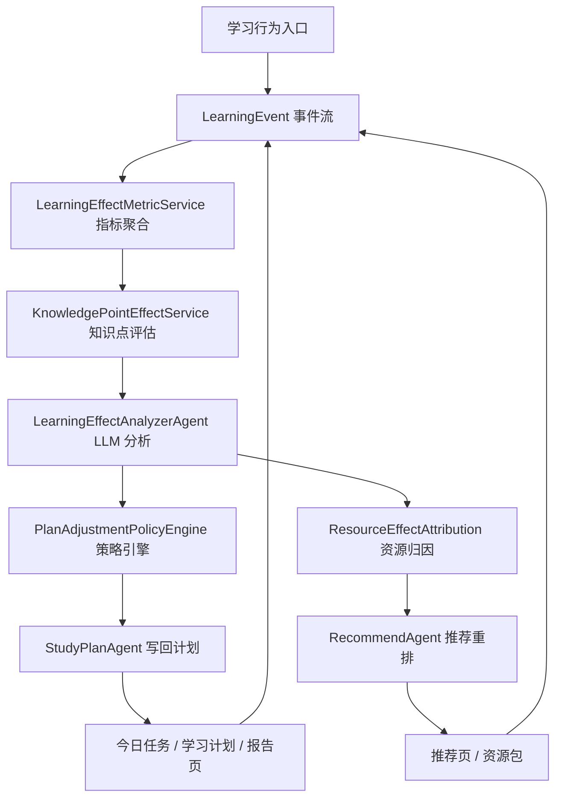

# A3 学习效果评估 v2 开发计划

> 后续开发必须先读本文件，再实现学习效果评估相关能力。本计划的目标是把当前“接口触发式反馈 + 规则报告”升级为“学习事件流 + 多维评估内核 + LLM 分析 Agent + 可评测策略引擎 + 效果归因推荐”的完整闭环。

## 1. 背景与目标

当前 A3 已经具备基础闭环：

- 资源包反馈会写入 `resourceFeedback`。
- 今日任务完成会写入 `lastTaskFeedback`。
- 每日反思会写入 `dailyReflections`。
- 资源包学习会写入 `resourcePackRuns`。
- `/api/learning/effect/report/` 能返回资源使用、计划执行和简单调整建议。
- 学习计划、今日任务、报告页、能力页已经能展示部分反馈写回证据。

但距离赛题“学习效果评估”加分项仍有五个缺口：

1. “实时跟踪”目前是接口事件触发式，不是完整事件流或埋点系统。
2. “大模型数据分析能力”目前偏 Agent 包装 + 规则计算，`LearningEffectAgent` 内部主要调用确定性统计函数。
3. “多维度精准评估”已有维度，但缺知识点级 learning gain、长期趋势、置信度、对比基线、资源类型效果归因。
4. “动态调整策略”已有 `increase_practice`、`reduce_load`、`reinforce_mastery`，但策略较粗，缺可评价的策略引擎。
5. 推荐调权已读取反馈，但还不是完整的效果归因推荐系统。

v2 目标：

```text
学习事件采集
-> 学习行为聚合
-> 知识点级掌握评估
-> LLM 诊断解释
-> 策略引擎生成计划调整
-> 推荐系统按效果归因重排
-> 后续行为继续回流评估
```

最终可以对外表述为：

```text
A3 已实现基于学习行为事件流、测评结果、资源反馈和画像信号的多维学习效果评估，并通过 Agent 分析动态调整学习计划和资源推荐策略。
```

禁止对外表述为：

```text
已实现全量实时埋点、成熟统计因果推断、完全由大模型自主优化。
```

除非这些能力已经被真实接口、页面和自动化测试验证。

## 2. 开发原则

- 后端内核优先，前端展示随后补齐。
- 评估结果必须来自真实数据，不能新增前端 mock。
- LLM 只能基于结构化证据分析，不能编造来源、页码、同伴数据或历史趋势。
- 数据不足时必须返回 `confidence=low` 和 `missingEvidence`，不能强行给精准结论。
- 所有策略调整必须可追踪、可解释、可回滚、可评价。
- 旧字段保持兼容，允许从事件表重建 `extra_profile` 缓存。
- 教师端和能力页只展示真实接口返回的证据。

## 3. 目标架构



建议新增或调整的后端模块：

```text
backend/apps/learning/models.py
backend/apps/learning/services.py
backend/apps/learning/effect_events.py
backend/apps/learning/effect_metrics.py
backend/apps/learning/plan_policy.py
backend/apps/compat/resource_generation.py
backend/apps/compat/recommendations.py
backend/apps/compat/views.py
backend/apps/compat/urls.py
backend/apps/assessments/services.py
backend/apps/profiles/services.py
```

建议新增或调整的前端模块：

```text
OpenMAIC/components/a3/features/report-view.tsx
OpenMAIC/components/a3/features/study-plan-view.tsx
OpenMAIC/components/a3/features/today-learning-view.tsx
OpenMAIC/components/a3/features/recommendations-view.tsx
OpenMAIC/components/a3/features/capabilities-view.tsx
OpenMAIC/lib/a3/learning-types.ts
OpenMAIC/lib/a3/recommendation-types.ts
```

## 4. 第一批：学习事件流

### 4.1 目标

把分散在 `extra_profile`、计划、资源包和测评里的行为数据统一沉淀为学习事件。后续评估、策略和推荐都优先读取事件流。

### 4.2 后端数据模型

建议新增模型 `LearningEvent`：

```python
class LearningEvent(models.Model):
    user = models.ForeignKey(settings.AUTH_USER_MODEL, on_delete=models.CASCADE, related_name="learning_events")
    event_type = models.CharField(max_length=64)
    target_type = models.CharField(max_length=64, blank=True, default="")
    target_id = models.CharField(max_length=128, blank=True, default="")
    knowledge_point_id = models.CharField(max_length=128, blank=True, default="")
    resource_type = models.CharField(max_length=64, blank=True, default="")
    duration_sec = models.PositiveIntegerField(default=0)
    score = models.FloatField(null=True, blank=True)
    quality = models.JSONField(default=dict, blank=True)
    metadata = models.JSONField(default=dict, blank=True)
    trace_id = models.CharField(max_length=128, blank=True, default="")
    created_at = models.DateTimeField(default=timezone.now)

    class Meta:
        indexes = [
            models.Index(fields=["user", "-created_at"]),
            models.Index(fields=["user", "event_type", "-created_at"]),
            models.Index(fields=["user", "knowledge_point_id", "-created_at"]),
            models.Index(fields=["user", "resource_type", "-created_at"]),
        ]
```

### 4.3 事件类型

首批必须覆盖：

```text
task_started
task_completed
resource_opened
resource_completed
resource_skipped
resource_favorited
assessment_started
assessment_submitted
question_answered
wrong_question_added
wrong_question_reviewed
coach_session_started
coach_message_sent
reflection_submitted
plan_adjusted
recommendation_shown
recommendation_clicked
```

### 4.4 服务接口

新增统一写入函数：

```python
def record_learning_event(
    user,
    *,
    event_type: str,
    target_type: str = "",
    target_id: str = "",
    knowledge_point_id: str = "",
    resource_type: str = "",
    duration_sec: int = 0,
    score: float | None = None,
    quality: dict | None = None,
    metadata: dict | None = None,
    trace_id: str = "",
) -> LearningEvent:
    ...
```

新增查询函数：

```python
def list_recent_learning_events(user, *, limit: int = 100) -> list[dict]:
    ...

def aggregate_learning_events(user, *, days: int = 30) -> dict:
    ...
```

### 4.5 接入点

必须接入：

- `complete_study_plan_task`
- `submit_daily_reflection`
- `record_resource_feedback`
- 测评提交和单题判分逻辑
- 错题复习逻辑
- 资源包加入今日任务
- AI 课堂/辅导消息发送
- 推荐卡片点击或收藏

### 4.6 接口

新增：

```text
GET /api/learning/events/recent/?limit=100
GET /api/learning/events/summary/?days=30
```

响应示例：

```json
{
  "success": true,
  "events": [
    {
      "eventType": "resource_completed",
      "targetType": "resource_pack",
      "targetId": "pack_123",
      "knowledgePointId": "kp_function",
      "resourceType": "practice_set",
      "durationSec": 900,
      "score": 82,
      "createdAt": "2026-07-08T10:00:00+08:00"
    }
  ]
}
```

### 4.7 验收标准

- 完成任务后能查到 `task_completed`。
- 提交测评后能查到 `assessment_submitted` 和 `question_answered`。
- 资源打开、完成、跳过、收藏能生成对应事件。
- `/api/learning/effect/report/` 开始读取事件聚合，而不是只读 `resourceFeedback`。
- 事件写入失败不能影响主流程，必须记录降级原因。

## 5. 第二批：多维学习效果评估内核

### 5.1 目标

把学习效果从“资源使用统计”升级为知识点级、趋势级、置信度明确的评估报告。

### 5.2 指标结构

`LearningEffectReport v2` 建议结构：

```json
{
  "schemaVersion": "a3.learning-effect.v2",
  "overallEffectScore": 76,
  "confidence": "medium",
  "missingEvidence": [],
  "timeWindow": {
    "days": 30,
    "startedAt": "2026-06-09",
    "endedAt": "2026-07-08"
  },
  "behavior": {
    "activeDays": 9,
    "totalDurationSec": 14400,
    "taskCompletionRate": 0.72,
    "reflectionCount": 4
  },
  "assessment": {
    "attemptCount": 6,
    "averageScore": 78,
    "correctRate": 0.74,
    "wrongQuestionCount": 12,
    "reviewedWrongQuestionCount": 5
  },
  "knowledgePoints": [
    {
      "knowledgePointId": "kp_function",
      "name": "函数基础",
      "preScore": 55,
      "postScore": 78,
      "learningGain": 23,
      "attemptCount": 8,
      "correctRate": 0.75,
      "wrongCount": 2,
      "reviewCount": 3,
      "trend": "improving",
      "confidence": "high",
      "evidence": ["assessment", "wrong_notebook", "task_completion"]
    }
  ],
  "trends": {
    "sevenDay": {},
    "fourteenDay": {},
    "thirtyDay": {}
  },
  "baseline": {
    "type": "self_history",
    "planExpectedCompletionRate": 0.8,
    "actualCompletionRate": 0.72
  }
}
```

### 5.3 核心计算

必须实现：

- 知识点前测分 `preScore`
- 知识点后测分 `postScore`
- 学习增益 `learningGain = postScore - preScore`
- 任务完成率
- 错题复发率
- 错题复习率
- 资源完成率
- 练习转化率
- 最近 7/14/30 天趋势
- 数据置信度

置信度规则建议：

```text
high:
  有 3 次及以上相关题目作答，且有任务或资源事件支撑
medium:
  有 1-2 次相关题目作答，或只有任务/资源行为支撑
low:
  数据不足，只能给观察性建议
```

### 5.4 数据不足处理

必须返回：

```json
{
  "confidence": "low",
  "missingEvidence": [
    "近 30 天测评数据不足",
    "该知识点缺少后测记录"
  ]
}
```

禁止：

- 没有测评数据却声称“掌握度显著提升”。
- 没有真实群体数据却声称“超过同龄人平均水平”。
- 没有时间序列却声称“长期趋势稳定改善”。

### 5.5 验收标准

- 报告能说明每个薄弱知识点的变化。
- 报告能说明计划执行和测评表现之间的关系。
- 数据不足时前端展示“不足以判断”，而不是空白或伪结论。
- 报告字段有测试覆盖。

## 6. 第三批：LLM 学习效果分析 Agent

### 6.1 目标

把确定性指标交给 LLM 做解释、风险判断和干预建议，但 LLM 不负责凭空计算事实。

### 6.2 Agent 分工

新增或升级：

```text
LearningEffectMetricAgent
  负责确定性指标聚合。

LearningEffectAnalyzerAgent
  负责基于指标、画像、错题、计划和资源反馈生成结构化分析。

LearningEffectVerifierAgent
  负责检查输出是否引用了输入证据，禁止无证据结论。
```

### 6.3 LLM 输入

LLM 输入只能包含结构化摘要：

```json
{
  "profileSnapshot": {},
  "dynamicProfileV2": {},
  "eventSummary": {},
  "assessmentSummary": {},
  "knowledgePointEffects": [],
  "resourceEffects": [],
  "planExecution": {},
  "missingEvidence": []
}
```

### 6.4 LLM 输出

必须是 JSON：

```json
{
  "schemaVersion": "a3.learning-effect-analysis.v1",
  "summary": "近 7 天学习完成率下降，主要集中在函数练习任务。",
  "riskLevel": "medium",
  "riskReasons": [
    {
      "reason": "函数基础相关题目连续错误",
      "evidenceKeys": ["knowledgePoints[0].wrongCount", "assessment.correctRate"]
    }
  ],
  "findings": [
    {
      "type": "knowledge_point",
      "targetId": "kp_function",
      "finding": "函数基础有进步，但错题复发仍高。",
      "confidence": "medium",
      "evidenceKeys": ["knowledgePoints[0].learningGain", "knowledgePoints[0].wrongCount"]
    }
  ],
  "nextIntervention": {
    "type": "add_remedial_practice",
    "reason": "需要短练习验证函数基础掌握情况。",
    "targetKnowledgePointId": "kp_function"
  }
}
```

### 6.5 降级策略

LLM 不可用、超时或输出不可解析时：

- 返回规则分析。
- `analysisSource` 设置为 `rules_fallback`。
- trace 记录 `degraded=true` 和原因。
- 前端显示“规则评估”，不能假装是大模型分析。

### 6.6 验收标准

- 有 LLM key 时返回结构化分析。
- 无 LLM key 时仍能返回规则报告。
- LLM 输出不允许包含未在输入证据中的事实。
- Agent trace 能在能力页或后端日志中追踪。

## 7. 第四批：动态计划调整策略引擎

### 7.1 目标

把学习效果分析转成可执行、可追踪、可评价的计划调整动作。

### 7.2 策略动作

首批支持：

```text
add_remedial_practice
add_spaced_review
reduce_new_content
increase_challenge
switch_resource_type
extend_deadline
recommend_coaching
notify_teacher
```

### 7.3 策略输出结构

```json
{
  "schemaVersion": "a3.plan-adjustment.v2",
  "strategy": "add_remedial_practice",
  "action": {
    "type": "add_task",
    "taskType": "practice",
    "title": "函数基础补救练习",
    "knowledgePointId": "kp_function",
    "estimatedMinutes": 15
  },
  "reason": "函数基础错题复发率高，且近 7 天该知识点后测不足。",
  "evidence": {
    "wrongCount": 3,
    "learningGain": 8,
    "confidence": "medium"
  },
  "expectedImpact": "降低函数基础错题复发率，并补齐后测证据。",
  "risk": "可能增加今日任务负担。",
  "expiresAt": "2026-07-15T00:00:00+08:00",
  "rollbackCondition": "连续两天未完成新增任务时撤销或减负。",
  "createdAt": "2026-07-08T10:00:00+08:00"
}
```

### 7.4 写回位置

写入学习计划：

```text
studyPlan.lastLearningEffectAdjustment
studyPlan.adjustmentTimeline[]
today.tasks[]
```

写入事件：

```text
plan_adjusted
```

写入报告：

```text
effectReport.planAdjustment
effectReport.adjustmentEvaluation
```

### 7.5 调整效果评价

每次策略调整后，后续报告必须评价：

- 新增任务是否完成。
- 目标知识点正确率是否提升。
- 错题复发是否降低。
- 用户是否跳过相关资源。
- 是否触发回滚条件。

### 7.6 验收标准

- 低完成率用户触发 `reduce_new_content` 或 `extend_deadline`。
- 某知识点连续错误触发 `add_remedial_practice`。
- 高掌握用户触发 `increase_challenge`。
- 调整动作显示在学习计划和今日任务。
- 报告显示“本次调整是否有效”。

## 8. 第五批：资源效果归因推荐

### 8.1 目标

推荐排序从简单反馈加减分升级为基于用户历史效果的资源归因。

### 8.2 归因维度

按以下维度统计：

```text
resourceType
knowledgePointId
difficulty
profileSegment
learningGoal
```

### 8.3 指标

```text
impressionCount
clickCount
openRate
completionRate
skipRate
favoriteRate
practiceConversionRate
postAssessmentGain
wrongQuestionReduction
averageDurationSec
effectConfidence
```

### 8.4 推荐排序因素

推荐总分建议：

```text
finalScore =
  profileMatchScore * 0.25
  + weakPointPriorityScore * 0.25
  + resourceEffectScore * 0.25
  + planFitScore * 0.15
  + citationTrustScore * 0.10
```

数据不足时：

```text
resourceEffectScore = explorationScore
reason = "探索推荐：当前资源类型历史证据不足，系统将根据完成情况继续校准。"
```

### 8.5 推荐理由结构

推荐卡片必须能解释：

```json
{
  "reason": "你过去完成短练习后，函数基础相关题目正确率提升，因此优先推荐练习资源。",
  "rankingBasis": [
    {"label": "画像匹配", "value": "目标为入门补弱"},
    {"label": "薄弱点", "value": "函数基础"},
    {"label": "历史效果", "value": "practice_set 完成后后测提升 12 分"},
    {"label": "证据置信度", "value": "medium"}
  ],
  "effectAttribution": {
    "resourceType": "practice_set",
    "knowledgePointId": "kp_function",
    "postAssessmentGain": 12,
    "effectConfidence": "medium"
  }
}
```

### 8.6 验收标准

- 跳过率高的资源类型自动降权。
- 完成后能带来后测提升的资源类型自动升权。
- 推荐理由显示资源效果归因证据。
- 推荐点击、打开、完成继续写入事件流。

## 9. 前端展示计划

### 9.1 报告页 `/a3/report`

新增模块：

- 学习效果总分
- 置信度和证据充分性
- 知识点增益列表
- 7/14/30 天趋势
- 本次计划调整原因
- 调整后效果评价
- LLM 分析摘要，降级时显示“规则评估”

### 9.2 学习计划页 `/a3/study-plan`

新增模块：

- `lastLearningEffectAdjustment`
- 调整动作详情
- 回滚条件
- 预计影响
- 调整来源 traceId

### 9.3 今日任务页 `/a3/today`

新增模块：

- 因学习效果评估新增的任务标记
- 新增任务原因
- 完成后会验证哪个知识点

### 9.4 推荐页 `/a3/recommendations`

新增模块：

- 资源效果归因说明
- 探索推荐标记
- 历史有效性证据
- 推荐反馈按钮继续写事件流

### 9.5 能力页 `/a3/capabilities`

新增证据：

- 最近学习事件数
- 效果报告 schema version
- Agent trace
- 是否 LLM 分析
- 是否降级
- 最近一次计划调整
- 推荐归因指标

## 10. 后端接口清单

新增或升级：

```text
GET  /api/learning/events/recent/?limit=100
GET  /api/learning/events/summary/?days=30
GET  /api/learning/effect/report/?days=30
POST /api/learning/effect/evaluate/
GET  /api/learning/effect/knowledge-points/?days=30
GET  /api/learning/effect/resource-attribution/?days=30
POST /api/learning/plan/adjust-from-effect/
```

兼容保留：

```text
POST /api/resources/packs/<pack_id>/feedback/
GET  /api/learning/study-plan/
GET  /api/assessments/report/
```

## 11. 测试计划

### 11.1 后端单元测试

建议新增：

```text
backend/apps/learning/tests/test_learning_events.py
backend/apps/learning/tests/test_learning_effect_metrics.py
backend/apps/learning/tests/test_plan_adjustment_policy.py
backend/apps/compat/tests/test_learning_effect_agent_v2.py
backend/apps/compat/tests/test_resource_effect_attribution.py
```

必须覆盖：

- 事件写入和查询。
- 事件聚合。
- 知识点 learning gain。
- 数据不足置信度。
- LLM 降级。
- 计划调整策略。
- 推荐归因调权。

### 11.2 前端测试

建议新增或扩展：

```text
OpenMAIC/e2e/tests/a3-learning-effect-v2.spec.ts
OpenMAIC/e2e/tests/a3-resource-effect-attribution.spec.ts
```

必须覆盖：

- 报告页展示学习效果 v2。
- 学习计划显示调整动作。
- 今日任务显示评估触发任务。
- 推荐页显示归因理由。
- 数据不足时显示低置信度提示。

### 11.3 验证命令

后端：

```powershell
cd D:\Download\A3
backend\.venv\Scripts\python.exe backend\manage.py check
backend\.venv\Scripts\python.exe backend\manage.py test backend.apps.learning.tests.test_learning_events
backend\.venv\Scripts\python.exe backend\manage.py test backend.apps.learning.tests.test_learning_effect_metrics
backend\.venv\Scripts\python.exe backend\manage.py test backend.apps.learning.tests.test_plan_adjustment_policy
backend\.venv\Scripts\python.exe backend\manage.py test backend.apps.compat.tests.test_learning_effect_agent_v2
backend\.venv\Scripts\python.exe backend\manage.py validate_demo_flow --skip-seed --strict
```

前端：

```powershell
cd D:\Download\A3\OpenMAIC
npx.cmd tsc --noEmit
pnpm.cmd lint
npx.cmd playwright test e2e/tests/a3-learning-effect-v2.spec.ts --project=chromium
```

## 12. Subagent-Driven 开发分工

后续执行时建议每批一个或多个 subagent，主 agent 负责评审和合并。

### Agent A：事件流内核

负责：

- `LearningEvent` 模型和 migration。
- `record_learning_event`。
- 行为入口接入。
- 事件查询接口。
- 后端测试。

不得负责：

- LLM 分析。
- 前端 UI。
- 推荐排序。

### Agent B：效果指标内核

负责：

- 事件聚合。
- 知识点 learning gain。
- 趋势和置信度。
- `/api/learning/effect/report/` v2。
- 指标测试。

不得负责：

- 页面样式。
- 策略写回。

### Agent C：LLM 分析 Agent

负责：

- `LearningEffectAnalyzerAgent`。
- JSON schema。
- 降级逻辑。
- Verifier 检查。
- Agent trace。

不得负责：

- 直接修改计划任务。
- 编造未输入证据。

### Agent D：策略引擎

负责：

- `PlanAdjustmentPolicyEngine`。
- 计划写回。
- 调整效果评价。
- 策略测试。

不得负责：

- 推荐排序。
- LLM prompt 大改。

### Agent E：推荐归因

负责：

- `ResourceEffectAttribution`。
- 推荐排序加权。
- 推荐理由和 evidence。
- 推荐相关测试。

不得负责：

- 学习计划写回。

### Agent F：前端展示

负责：

- 报告页。
- 学习计划页。
- 今日任务页。
- 推荐页。
- 能力页。
- e2e 测试。

不得负责：

- 新增前端 mock 冒充后端数据。

## 13. 分批里程碑

### M1：事件流可用

完成后应具备：

- 所有关键行为写入 `LearningEvent`。
- 能查询最近事件和事件摘要。
- 原有流程不回退。

### M2：评估报告 v2 可用

完成后应具备：

- `/api/learning/effect/report/` 返回 v2 schema。
- 包含知识点、趋势、置信度、缺失证据。
- 报告页能展示核心指标。

### M3：LLM 分析可用

完成后应具备：

- 有 key 时结构化分析。
- 无 key 时规则降级。
- trace 可查。

### M4：计划动态调整可用

完成后应具备：

- 策略引擎生成具体动作。
- 动作写回今日任务和学习计划。
- 后续报告评价调整效果。

### M5：推荐归因可用

完成后应具备：

- 推荐排序读取资源效果归因。
- 推荐理由显示历史效果证据。
- 推荐反馈继续回流事件流。

## 14. 完成定义

本计划完成必须同时满足：

- 后端接口真实返回 v2 数据。
- 前端页面展示真实接口数据。
- 测评、错题、资源、任务、反思至少五类事件接入。
- LLM 分析有结构化输出和降级路径。
- 计划调整有具体任务写回。
- 推荐有资源效果归因说明。
- 自动化测试覆盖核心链路。
- `/a3/capabilities` 能展示学习效果评估闭环证据。

## 15. 风险与边界

### 15.1 迁移风险

新增事件表后，旧数据仍在 `extra_profile` 中。第一版允许：

- 新事件写入事件表。
- 老数据作为 fallback 读取。
- 后续单独做 backfill migration。

### 15.2 LLM 风险

LLM 输出必须受 schema 和 verifier 限制。不能让 LLM 自行决定事实、分数或来源。

### 15.3 性能风险

事件表必须加索引。报告聚合默认查近 30 天，避免全表扫描。

### 15.4 产品风险

不要为了展示“精准”而过度下结论。数据不足时明确提示不足，反而更可信。

## 16. 后续执行入口

推荐下一步先写详细实现计划：

```text
docs/superpowers/plans/2026-07-08-a3-learning-effect-v2.md
```

然后使用 Subagent-Driven 方式执行：

```text
Task 1: LearningEvent 模型和事件服务
Task 2: 行为入口接入事件流
Task 3: 学习效果指标聚合
Task 4: LLM 分析 Agent 和降级
Task 5: 策略引擎和计划写回
Task 6: 资源效果归因推荐
Task 7: 前端展示和 e2e
Task 8: 能力页证据和验收命令
```
